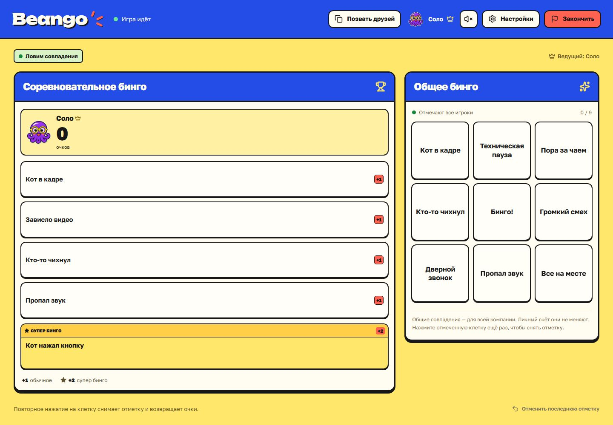

# Beango — Стикер пати

Браузерная игра для 1–4 игроков: соло или с друзьями. Каждый готовит свой словарь, ведущий отмечает совпадения и начисляет очки. Рядом работает общее бинго. ПК и телефоны подключаются к одному локальному серверу и видят изменения сразу.

## Готовая версия для Windows

Скачайте **Beango-win-x64.zip** из [релизов](https://github.com/Nefritor/Beango/releases), распакуйте в обычную папку и запустите **Beango.exe**. Node.js устанавливать не нужно. Откроется браузер с игрой: **http://localhost:54321**. Окно сервера оставьте открытым; закрытие окна или Ctrl+C останавливает игру.

Для внешнего доступа один раз запустите **Enable Internet.cmd**, подтвердите Windows и перезапустите Beango. Кнопка **«Позвать друзей»** в шапке копирует внешний адрес. В локальной сети используется IP компьютера и порт 54321. Для прямого подключения из интернета нужны публичный IPv4 и TCP-проброс на роутере. Инструкция ниже описывает ручную настройку и CGNAT.

Состояние игры сохраняется в папке `data` рядом с exe. Настройки читаются из необязательного `.env` рядом с exe; пример — `.env.example`. Значения из этого файла имеют приоритет над переменными окружения Windows. Поддерживаются UTF-8 и UTF-16 с BOM. Путь прочитанного `.env` выводится в окне запуска. После изменения файла остановите сервер и запустите его снова: уже работающая игра не перечитывает конфигурацию. Повторный запуск без остановки открывает уже работающий сервер. Аргумент `--no-open` запускает сервер без открытия браузера. Визуальные ресурсы и сервер включены в exe, изображения и шрифты работают без внешних сервисов.

## Запуск на Windows

Для запуска **из исходников** нужен **Node.js 24 или новее**.

Дважды нажмите **Start Beango.cmd**. При первом запуске установятся зависимости, затем соберётся и запустится игра. Откройте **http://localhost:54321**. Окно запуска нужно оставить открытым; **Ctrl+C** останавливает сервер.

Через терминал:

```powershell
npm ci
npm run build
npm start
```

Сервер слушает `0.0.0.0:54321`. Участники в той же сети открывают адрес компьютера, например `http://192.168.1.100:54321`. Текущие адреса выводятся при запуске и находятся у ведущего в настройках игры.

## Доступ из интернета

Запустите **Enable Internet.cmd** и подтвердите запрос Windows на права администратора. Скрипт:

1. Создаёт входящее правило Windows Firewall только для TCP-порта игры и используемого `node.exe`.
2. Через UPnP настраивает на роутере проброс этого TCP-порта на локальный адрес компьютера.
3. Сохраняет внешний адрес в `.env` как `PUBLIC_URL`. Результат записывается в `data/network-access.json`.

После этого запустите или перезапустите игру. В настройках появится отдельная ссылка для друзей из интернета. Компьютер и сервер должны оставаться включёнными.

Если UPnP недоступен, настройте на роутере правило вручную: **внешний TCP 54321 → локальный IP компьютера, TCP 54321**. Для входящего Windows-правила можно выполнить от администратора:

```powershell
New-NetFirewallRule -DisplayName 'Beango TCP 54321' -Direction Inbound -Action Allow -Protocol TCP -LocalPort 54321 -Program (Resolve-Path .\Beango.exe).Path
```

Скопируйте `.env.example` в `.env`, укажите `PUBLIC_URL=http://ВАШ_ПУБЛИЧНЫЙ_IP:54321` и перезапустите сервер. Если внешний порт 54321 занят, выберите другой:

```powershell
.\scripts\Network-Access.ps1 -Mode Enable -ExternalPort 13000
```

Прямой вход требует доступного из интернета публичного IPv4. При CGNAT проброс на домашнем роутере не создаст внешний доступ — понадобится публичный адрес от провайдера. Проверять ссылку нужно с другой сети, например на телефоне с выключенным Wi-Fi. При смене локального или внешнего IP повторите настройку; удобно закрепить адрес компьютера в DHCP роутера.

**Disable Internet.cmd** удаляет только правило игры и созданный ею UPnP-проброс. Другие правила и подключения он не меняет.

Текущая конфигурация рассчитана на прямой TCP-проброс к Node.js. Не ставьте перед приложением HTTP-прокси, скрывающий адрес клиента: права ведущего определяются фактическим IP подключения. `X-Forwarded-For` и похожие заголовки не используются для выдачи прав.

## Как играть

1. Введите имя и выберите одну из 12 аватарок. Первый игрок из локальной сети становится ведущим и тоже занимает игровое место.
2. Заполните обычные варианты и отдельное супер бинго. Нажмите «Я готов». До старта ваши варианты видны только вам.
3. Ведущий запускает игру, когда готовы и подключены все 1–4 игрока.
4. В соревновательном поле только ведущий отмечает совпадения. Обычный вариант даёт **1 очко**, супер бинго — **2**. Повторное нажатие снимает отметку и вычитает соответствующие очки. Клетку можно отметить снова; в текущем счёте она учитывается один раз.
5. Для общего поля в настройках выбирается режим «Все игроки» или «Только ведущий». Эти же права действуют для снятия отметки повторным нажатием. Общее поле не меняет личный счёт. Снятие отметки не запускает праздничный эффект.
6. Ведущий может отменить последнюю отметку. Кнопка «Закончить» показывает результаты. При равном счёте игроки делят место.
7. Новый раунд сохраняет словари; их также можно очистить перед следующей игрой.

На телефоне поля переключаются вкладками, а игрок выбирается в верхней полосе счёта. Звук и спокойный режим эффектов настраиваются отдельно на каждом устройстве.



Соло-игра использует те же правила: заполните свой словарь, нажмите «Я готов» и «Начать игру». Кнопка «Позвать друзей» доступна в шапке всем участникам, когда настроен внешний адрес. Адреса в настройках используют обычный шрифт интерфейса.

В настройках ведущего доступны 4–8 обычных вариантов, поле 3 × 3 или 4 × 4 и редактирование общего словаря. Размеры и словари меняются между раундами; права на общее поле можно менять и во время игры. Длинные тексты в клетках сокращаются визуально, полная фраза остаётся в доступном имени кнопки и подсказке.

## Сохранение и повторный вход

Комната автоматически сохраняется в `data/room.json`. После перезапуска остаются игроки, словари, отметки, история отмены и счёт. Присутствие определяется активным соединением и после перезапуска восстанавливается заново.

Сессия хранится в HttpOnly-cookie браузера. Обновление страницы или повторное открытие того же адреса возвращает игрока в его место. `localhost`, `127.0.0.1` и IP компьютера — разные адреса для cookie: для возвращения используйте прежний адрес.

Новые участники входят между играми. Ведущий может освободить место игрока в комнате перед стартом. Если ведущий потерял cookie или закрыл вкладку, пользователь из локальной сети может восстановить роль: уже вошедший — кнопкой «Взять роль ведущего», не вошедший — «Восстановить роль ведущего». Пока прежний ведущий подключён, перехват роли запрещён. Внешним пользователям эти действия недоступны.

## Настройка

Все параметры необязательны. Без `.env` используются значения ниже.

| Параметр | По умолчанию | Назначение |
| --- | --- | --- |
| `HOST` | `0.0.0.0` | Адрес, на котором слушает сервер |
| `PORT` | `54321` | TCP-порт |
| `DATA_DIR` | `./data` | Папка сохранения комнаты |
| `PUBLIC_URL` | пусто | Внешняя ссылка для приглашения |
| `ALLOWED_HOSTS` | пусто | Дополнительные разрешённые домены через запятую; IP и localhost работают сразу |
| `TRUSTED_LAN_CIDRS` | определяется | Подсети ведущего через запятую, например `192.168.31.0/24`; loopback доступен всегда |

## Разработка и проверка

```powershell
npm run dev
npm run check
npm run build
npm run build:exe
```

Режим разработки открывается на `http://127.0.0.1:5173`; Vite проксирует API и WebSocket на локальный сервер `127.0.0.1:3001`. Для гостей из интернета используется собранная игра через `npm start`.

Проверки покрывают соло-игру, начисление и снятие очков, отмену после снятия отметки, повторные запросы, права гостей и ведущего, готовность, отсутствие игрока в сети, лимит комнаты, новый раунд, сохранение после перезапуска, подмену IP-заголовков, Origin/Host и реальные HTTP/WebSocket-соединения. Windows-сборка создаётся через Node.js SEA и postject, результат — `release/Beango-win-x64/Beango.exe`. Скрипт `npm run test:exe` проверяет exe в отдельной папке без Node.js в PATH.

## Структура

- `client/` — React-интерфейс, адаптивная компоновка, звук и эффекты.
- `server/` — правила игры, HTTP/WebSocket, проверка прав, сохранение.
- `shared/` — общие типы и актуальный набор аватарок.
- `concepts/` — утверждённые макеты, исходные PNG и промпты.
- `public/avatars/` — компактные WebP для игры; готовятся автоматически из актуального `concepts/manifest.json`.
- `scripts/` — запуск и настройка сети.

[Документ концепта](https://chatgpt.com/space/page_7e9d482315f08191a794b30541f4e32a). Используются [Vite](https://vite.dev/guide/), [React](https://react.dev/) и [ws](https://github.com/websockets/ws).
